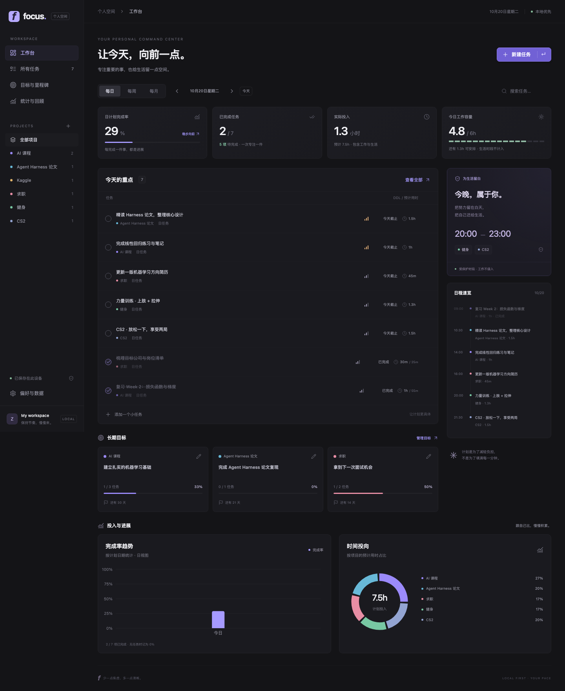

# Focus · 个人工作台

一个可以在 Mac 本地浏览器使用，也能打包安装到 vivo / 其他安卓手机的个人任务仪表盘。Next.js + TypeScript + Tailwind CSS + Recharts，Linear 风格暗色界面。无需账号、服务器或云服务配置。

安卓 1.1.0 已集成 **Qwen3.5 4B / 9B 离线助手**：本机问答、流式回复、一句话生成可编辑任务草稿。模型单独导入，任务经确认后保存。见 [本地 AI 使用与构建指南](docs/local-ai/README.md)。



## 直接在安卓手机使用

已提供 Android Studio 工程 `android/`。构建产物为 `releases/focus-dashboard-debug.apk`。这是本地安装用的调试版，不依赖 Mac 开机，不需要访问网页服务器。

1. 将 APK 传到 vivo 手机，在文件管理器中打开。
2. 按手机提示允许当前文件管理器安装此应用，完成安装。
3. 打开 **Focus 工作台**。安装后可以断网运行。
4. 首次展示的是可编辑的示例任务；可在「偏好与数据」中清空任务与目标，再录入自己的计划。

详细的 Android Studio、USB 真机运行、升级、备份说明见 [安卓与 vivo 安装指南](docs/ANDROID.md)。

## Mac 本地启动

安装 Node.js 22 或更新版本（建议 LTS），在项目目录运行：

```bash
npm ci
npm run dev
```

浏览器打开 <http://localhost:3000>。停止时在终端按 Ctrl+C。

日常使用也可以运行构建后的静态版本：

```bash
npm run build
npm start
```

同样打开 <http://localhost:3000>。`out/` 包含完整静态产物；本项目没有服务端 API。请通过本地服务器打开，不能双击 `out/index.html`。如果端口被占用，请先停止占用它的旧服务。日常使用尽量固定浏览器、地址和端口；`localhost`、`127.0.0.1`、局域网 IP 的浏览器数据互相独立。

## 功能与默认规则

- 手动添加、编辑、删除、完成、重新打开任务；记录备注、优先级、计划日期、DDL、开始时间及预计/实际分钟数。
- 每日、每周、每月为**计划粒度**，不会自动生成重复任务。周从周一开始，月按自然月计算。页面周期筛选依据计划日期；「所有任务」也遵循当前所选日期范围，可切换周/月或前后周期查看。
- Goal → Milestone → Task：在目标页管理里程碑，在任务编辑器关联。目标进度 = 关联任务已完成数量 ÷ 关联任务总数量；任务等权，无任务为 0%。删除目标/里程碑会解除任务关联，保留任务。
- 日视图显示当日完成率；周视图按七天显示；月视图按当月连续七天分组。柱状图按计划日期统计，饼图按项目的**预计用时**统计；均受项目和搜索筛选影响。当前完成状态会用于回顾，不是不可变的历史快照。
- DDL 倒计时按日历天计算，完成任务不再显示逾期；时区默认 Europe/London，可在设置中更换。
- 工作容量默认每天 360 分钟。容量卡按所选日期汇总全部工作项目，生活项目不计入；已完成任务仍占当日计划容量。超载时提示调整计划。实际用时手动填写，完成任务不会虚构实际时长。
- **20:00–23:00 受保护**：有开始时间的工作任务只要与此区间重叠就禁止保存（包括 19:30 开始、延伸到 20:00 之后的任务）。健身/CS2 等生活项目可以安排。无开始时间的任务不会被自动排入任何时段；不支持跨午夜排程。
- 未完成日任务在次日、周任务在下一周、月任务在下一月可一键结转。只移动计划日期，保留 DDL、实际用时、开始时间和结转记录。可开启自动结转：打开应用或页面跨日时执行，关闭应用后不在后台运行。结转会改变历史图表的计划归属。
- 六个初始项目：AI 课程、Agent Harness 论文、Kaggle、求职、健身、CS2，可改名、改色及调整工作/生活归类。已有任务/目标的项目需先迁移内容才能删除。
- JSON 导入导出、替换前确认、格式/版本/引用完整性检查及上一次保存自动备份。导入上限 8 MB。不合法数据不会覆盖原数据。

## 数据保存与设备迁移

浏览器使用 `localStorage`，安卓使用 Capacitor Preferences 对应的 **Android SharedPreferences**。安卓中的 WebView 缓存不是数据来源；应用进程被结束后仍可恢复。SharedPreferences 适合本 MVP 的轻量数据；大量历史任务可后续迁移至 SQLite。

保存成功后才更新界面；失败会显示提示。浏览器检测其他标签页更新并检查过期写入。尽量不要在多个标签页同时编辑同一任务。不要清除浏览器站点数据或手机应用数据；卸载安卓应用会删除本机数据。安卓系统云备份已关闭，请自行导出备份。

Mac → vivo：Mac 中「偏好与数据 → 导出 JSON」，通过 USB 或自己选择的文件传输方式把文件放到手机，再在安卓应用中「导入备份」。反向迁移同理。**目前没有自动跨设备同步。**

安卓导出调用系统文件保存窗口，可选择「下载」等本地文件夹，无需广泛存储权限。恢复上一次保存会恢复最近一次修改前的整个状态。数据损坏时显示恢复入口，不会自动覆盖损坏原文。

## 构建与同步 Android Studio

前提：Android Studio 2025.2.1 或更新版本、JDK 21、Android SDK Platform 36、Node.js 22+，以及 NDK 28.2.13676358、CMake 3.22.1（SDK Manager 安装）。首版原生 AI 构建 arm64-v8a。

```bash
npm ci
npm run android:sync
npm run android:open
```

`android:sync` 会构建 Next.js 静态资源并复制到 `android/`，再打开 Android Studio 即可。修改网页功能后重复同步；只在 Android Studio 点 Run 不会自动更新网页源代码。

命令行构建 APK：

```bash
npm run android:apk
```

连接并授权**一台**安卓设备后构建、覆盖安装并启动：

```bash
npm run android:install
```

脚本只对当前进程设置 Java/SDK 路径，不修改系统环境。`android/local.properties` 是自动生成的本机路径，不提交 Git。首次构建需要联网下载依赖；应用安装后无需联网。本机已有的 `android/` 不需要再次执行 `cap add android`。

## 操作与测试

```bash
npm run typecheck
npm test
npm run build
npx playwright install chromium
npm run test:e2e
```

浏览器测试使用构建后的 `out/`，覆盖桌面和手机尺寸。测试会独立启动静态服务器；如果 3000 已运行同项目的新静态版本则复用。若旧开发服务占用端口，先关闭它再测。

安卓冒烟测试（先安装调试 APK，并仅启动一台模拟器）：

```bash
node scripts/test-android.mjs
```

此脚本仅选择模拟器，不操作物理手机。测试包含任务写入、完成、结束进程、清除 WebView 缓存后的持久化验证、安卓返回键、JSON 导入和宽度适配。首次接触应用，可按 [人工验收清单](docs/TESTING.md) 操作。实际执行结果见 [验证记录](docs/VALIDATION.md)。

## 代码结构

```text
app/                 页面、表单、响应式暗色界面
lib/model.ts         日期/周期、数据校验、目标进度、容量、结转
lib/storage.ts       浏览器与安卓仓储、备份导出
lib/native.ts        平台判断与设备存储适配
android/             可直接导入 Android Studio 的原生工程
scripts/             Android 构建、安装与模拟器测试
supabase/            后续云同步的 SQL 草案，不会自动连接/执行
docs/                使用、测试、同步设计与预览
```

## 安卓本地 AI（1.1.0）

同一 App 内通过 llama.cpp 原生引擎运行 Qwen3.5-4B / 9B，支持模型导入、校验、加载、流式问答、停止生成及任务草稿确认。每次只加载一个，模型单独导入，APK 无 Internet 权限。浏览器版保留手动工作台，不提供本地推理。使用、固定模型下载和源码构建说明见 [本地 AI README](docs/local-ai/README.md)。

## Supabase 后续计划

已经通过 `DashboardRepository` 隔离数据存储。下一阶段可加入 Supabase Auth、用户隔离、带版本号的云端快照、离线待同步队列和冲突选择；详见 [同步设计](docs/SUPABASE.md)。首版没有 Supabase 依赖、账号界面或云端读写，也没有任何密钥。

## 开源到 GitHub

采用 MIT 许可证，欢迎通过 Issue 反馈问题、通过 Pull Request 改进。开发与检查流程见 [贡献指南](CONTRIBUTING.md)，1.1.0 的功能和限制见 [版本说明](docs/RELEASE-v1.1.0.md)。模型和原生依赖保留各自许可，详情见 `public/licenses/`。

`.gitignore` 已排除依赖、构建缓存、本机 SDK 路径、APK、模型权重与签名密钥。请勿提交个人 JSON 备份、聊天内容或密钥。APK 适合作为 GitHub Release 附件单独提供；仓库含 GitHub Actions 工作流用于网页测试与调试 APK 构建。

## 当前边界

没有账号、自动同步、后台提醒、日历同步、自动排程或循环任务生成；没有 Play 商店发布、正式签名。浏览器模拟手机尺寸与安卓模拟器测试都无法代替具体机型测试。清空计划后仍可保留六个类别与容量偏好。

## 官方参考

- [Capacitor 安装与 Android 工程](https://capacitorjs.com/docs/getting-started)
- [构建与同步工作流](https://capacitorjs.com/docs/basics/workflow)
- [Preferences 持久化](https://capacitorjs.com/docs/apis/preferences)
- [Android 文档保存机制](https://developer.android.com/training/data-storage/shared/documents-files)

## 1.0.1 更新

修复安卓工作台滚动：主内容使用独立纵向滚动容器；弹窗关闭后释放背景滚动锁；新增真实触摸与安卓手势回归。覆盖安装保留本机任务数据。

## 安卓 1.0.2：120 Hz 适配

原生窗口与 Android 15+ 的 WebView 主动请求当前屏幕支持的最高刷新率（上限 120 Hz）。回到前台、恢复焦点及折叠屏配置变化时重新计算；离开应用释放请求，不使用后台刷新循环。vivo V2436A 展开屏实测从约 60 提升到 120 Hz，真实滑动期间 WebView 帧回调约 120 FPS。系统省电、温控和应用刷新率策略仍由手机管理。

运行 `node scripts/test-android-refresh.mjs --serial YOUR_DEVICE_SERIAL` 可在前台应用进行有限时长的真实滑动采样，不修改任务。采样方法和限制见 [Android 指南](docs/ANDROID.md) 与 [验证记录](docs/VALIDATION.md)。
