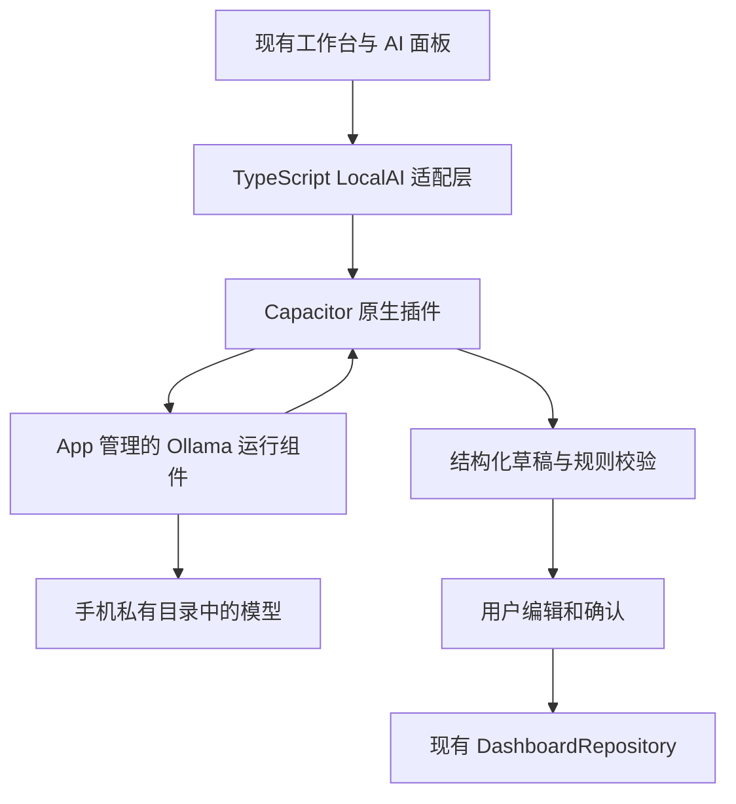

# Focus 工作台 · 本地 Qwen 4B 集成方案

版本：方案草案 v0.1 · 2026-10-20。

**目标：在现有 Focus 工作台安卓 App 内运行 Qwen 4B，让手机离线完成任务理解与计划建议。** 沿用当前 Next.js + Capacitor 界面与数据仓储，优先验证内嵌 Ollama 路线。

本文是待实施 README。当前稳定版本为 1.0.2，已有本地任务、目标、统计、备份与 120 Hz 适配；尚未接入 AI、打包 Ollama 或下载模型。下文的组件、接口及 AI 页面均为设计，不表示已经可用。

## 1. 交付目标和首版范围

最终用户只需安装 Focus 工作台，再从手机文件中导入模型。推理在手机上完成，不依赖 Mac 常驻服务、Termux、另一个 Ollama App、账号或云端 API。

首版优先交付：

- 模型管理：导入、校验、加载、卸载、删除，显示文件大小与状态。
- AI 助手：输入中文，流式显示回复，随时停止生成。
- 一句话添加任务：生成一至三个任务草稿，用户编辑并确认后写入工作台。
- 根据选中任务回答问题，例如解释当天容量与临近 DDL。

后续再增加 Goal → Milestone → Task 分步拆解、日计划与周报。大批量拆解采用多步生成，避免单次回复截断。图片、语音、论文 PDF 检索、联网搜索、自动操作其他 App 和后台常驻 Agent 不列入首版。

## 2. 已检查的设备与工程

| 项目 | 结果 | 说明 |
| --- | --- | --- |
| 真机 | vivo V2436A，Android 16 / API 36 | 当前已连接并使用工作台的手机 |
| 芯片 | SM8650，骁龙 8 Gen 3 | arm64-v8a |
| 内存 | 系统总计约 14.9 GiB，16 GB 级设备 | 不把 Swap 当作物理内存 |
| 可用内存 | 检查时约 8.4 GiB | 瞬时值，不是本 App 的独占额度 |
| 可用存储 | 检查时 /data 约 353G | 导入时仍需重新检查空间 |
| 现有应用 | Next.js 静态资源 + Capacitor 8 + Java 插件 | 保留界面和原有功能 |
| 数据 | 安卓 SharedPreferences；浏览器 localStorage | 继续由 DashboardRepository 管理 |
| 原生工程 | min SDK 24，compile / target SDK 36 | AI 首版只承诺经验证的 arm64 真机；其他设备保留基础工作台 |
| 网络权限 | 当前 APK 没有 Internet 权限 | 若采用本机 HTTP 通信，需要在 AI 版本增加该权限 |

硬件内存和存储来自此前的只读真机检查，均会随使用情况变化。原生开发环境还需安装并固定 Android NDK / CMake；嵌入 Ollama 还需要与其源码匹配的 Go / C/C++ 工具链。

## 3. Ollama 路线的决策与验证门槛

Ollama 官方当前列出的安装平台是 macOS、Windows、Linux。社区 [OllamaServer](https://github.com/sunshine0523/OllamaServer) 提供安卓本地运行方案，可作为研究参考；它不是官方 Android SDK。

**不能将社区 APK 或 Linux ARM64 安装包直接复制进当前工程。** 已查看的 OllamaServer 顶层 Gradle 配置将 target SDK 默认设为 28，并允许属性覆盖；当前工作台 target SDK 为 36。社区项目能运行，不代表其打包与启动方法可以原样用于本 App。

Android 对以 API 29+ 为目标的普通应用限制从可写应用目录执行文件。因此，必须先验证 APK 内的原生运行组件、runner 子进程启动、动态库解析、模型目录以及当前系统的兼容性；不通过降低工作台 target SDK 或要求 root 解决。

### 决策顺序

1. **优先：内嵌 Ollama。** 固定源码版本，构建适配 arm64-v8a 的运行组件，在同一 App 内管理启动、模型注册、生成、取消和退出。
2. 在 Android 16 / target 36 的普通应用环境下证明完整链路可用，再开发完整 AI 页面。
3. 若 Ollama 的打包、进程管理或性能门槛无法通过，记录结果，提出直接集成 llama.cpp JNI 的替代方案。接口预先隔离，但本文不将替代方案标成已选定或已实现。

社区 App 单独安装成功只算参考结果；**同一 APK、相同 target SDK、普通应用权限下跑通**才算当前项目的集成验证。

来源：[Ollama 官方仓库](https://github.com/ollama/ollama)、[OllamaServer 构建配置](https://github.com/sunshine0523/OllamaServer/blob/master/android/build.gradle)、[Android 可执行文件限制](https://developer.android.com/about/versions/10/behavior-changes-10#execute-permission)。

## 4. 模型与默认参数

| 候选 | 计划用途 | GGUF Q4_K_M 文件 |
| --- | --- | --- |
| Qwen3.5-4B | 主候选，首版仅文本 | [Unsloth 量化版约 2.74 GB](https://huggingface.co/unsloth/Qwen3.5-4B-GGUF/tree/main) |
| Qwen3-4B-Instruct-2507 | 对照与回退候选，纯文本、非思考模式 | [Unsloth 量化版约 2.50 GB](https://huggingface.co/unsloth/Qwen3-4B-Instruct-2507-GGUF/tree/main) |

4B 是参数规模，Q4 是量化精度。上述量化文件由 Unsloth 发布，不应标为 Qwen 官方量化文件。模型是否可加载，还要匹配选定 Ollama 版本对架构、量化和聊天模板的支持。

初始配置：

| 参数 | 默认设计 |
| --- | --- |
| 上下文 | 4096 tokens；为输出预留额度，长任务清单先筛选或摘要 |
| 输出 | 普通回复最多 512 tokens；首版任务草稿一至三个 |
| 思考模式 | 关闭；使用该模型与引擎实际支持的控制方式 |
| CPU 线程 | 比较 2 / 4 线程，先以 4 线程为基线 |
| 同时生成 | 1 个请求，重复点击不启动第二个模型实例 |
| 生成超时 | 暂定 120 秒；加载单独计时，用户始终可以取消 |
| 前台空闲释放 | 暂定 60 秒后卸载模型，可由实测调整 |
| 进入后台 | 取消生成并释放模型；恢复后由用户重新发起 |
| 首版模型常驻数 | 1 个 |

Qwen3.5 默认会思考，官方说明不支持 Qwen3 的 `/think`、`/nothink` 软切换。内嵌 Ollama 必须验证 `think` 配置及导入后的聊天模板；不能只在提示词中写 `/nothink`，也不能假定每个导入模型都支持相同参数。参见 [Qwen3.5 官方模型卡](https://huggingface.co/Qwen/Qwen3.5-4B) 与 [Ollama Chat API](https://docs.ollama.com/api/chat)。

短上下文先按 **4–6 GB 运行内存预算**设计，包含权重、缓存和运行缓冲；这是估算，不是该手机的实测峰值。GPU 副本与引擎分配方式可能增加占用。首版不采用 BF16 原始权重，不默认开启超长上下文。

## 5. 计划架构



前端不直接启动进程或拼接命令。原生层负责模型文件、运行时生命周期、后台线程、取消、超时与流式事件。模型只能产生建议，不能直接写入 SharedPreferences。

### 进程和通信

- 优先验证由 App 管理的运行组件和进程生命周期；不得将普通 Android Service 当作无限期后台运行保证。
- 若内嵌 Ollama 需要 HTTP，原生适配层连接固定为本机回环地址的运行组件，再向 WebView 提供插件事件。端口不硬编码占用当前网页开发端口，也不监听 `0.0.0.0`。
- 本机 HTTP 方案需要 Internet 权限，但离线推理仍不需要外部网络。前端继续保持禁止混合内容，不为了本机调用全面开放 WebView 明文访问。
- 回环地址不是同一手机各 App 之间的权限隔离。定版前需验证可信 IPC 或有效的访问控制；仅使用随机端口、隐藏 URL 或 CORS 不能算隔离。
- 退出或结束 AI 会话时终止相关生成、关闭自有连接并回收 runner；进程意外退出只影响 AI 面板，基础工作台保持可用。

后续若改为 JNI 直接推理，保留前端和插件的行为约定，移除不再需要的本机 HTTP 通信和权限。

## 6. 计划中的插件接口

以下接口尚不存在，不应作为当前可调用 API 使用。

| 操作 | 用途 |
| --- | --- |
| `getStatus()` | 返回引擎、模型、加载/生成状态和可用性 |
| `importModel()` | 调起系统文件选择器，原生流式复制与校验 |
| `listModels()` | 列出已导入模型与大小，不把绝对文件路径暴露到前端 |
| `loadModel(modelId)` | 加载已经校验且属于本 App 的模型 |
| `generate(request)` | 接收请求 ID、功能类型和受限上下文，异步返回事件 |
| `cancel(requestId)` | 取消指定生成，并确认计算已停止 |
| `unloadModel()` | 释放权重和运行缓冲 |
| `deleteModel(modelId)` | 确认后删除所选模型，先处理使用中的实例 |

事件包含 `requestId`，类型为状态、文本片段、完成、取消或错误。取消后、会话切换后和旧页面销毁后的事件不再更新界面。不能仅停止前端显示而让手机继续计算。

Ollama 适配层负责解析流式响应、模型注册、思考设置和资源释放。结构化回复可以使用其 JSON/schema 格式，但仍必须做应用层校验。GGUF 导入需要完成 Ollama 模型注册及模板验证，不能把“文件复制成功”显示为“模型可用”。见 [模型导入](https://docs.ollama.com/import) 与 [Chat API](https://docs.ollama.com/api/chat)。

## 7. 用户操作流程

### 首次准备模型

1. 在「偏好与数据 → 本地 AI」选择「导入模型」。
2. 用系统文件选择器选择支持的 GGUF；显示模型来源、量化、大小和校验状态。
3. 检查可用空间，流式复制到 App 私有目录的临时文件，支持取消。
4. 校验文件、架构、来源提供的 SHA-256（如有）和聊天模板；注册模型并运行短自检。
5. 自检通过后才标记为可用。任一步失败保留原有可用模型，清理本次临时产物。

APK 包含运行代码，模型单独导入，不将数 GB 权重塞进任务 JSON、SharedPreferences 或 Git 仓库。模型只从既定来源导入；任意文件的自算摘要仅能用于一致性检查，不能证明来源可信。

导入时暂按“待导入模型大小 × 3 + 1 GB”的空间预算检查，以容纳临时复制和 Ollama 模型存储的可能副本。验证实际去重方式后再缩减预算，不假定注册过程零复制。内存复制必须有界，不一次性读取整个模型。

### 一句话添加任务

输入示例：“明天下午学一小时 AI 课程，周五前完成。”

AI 返回可编辑草稿，展示项目、计划日期、DDL、开始时间和预计分钟数。不明确的字段留待确认，不编造已经完成或实际用时。用户点击「加入任务」后，才通过原有校验与仓储保存。

“明天”“本周五”按照 App 设置中的时区和请求时的日期解析；生成期间跨日或原始数据改变时，应用前重新检查。项目只能引用当前项目 ID；无法确定项目时让用户选择，不擅自新建近似名称。

### 无模型和失败状态

未导入、加载失败、内存不足、生成中断时，给出可操作的状态和重试入口。已有任务、统计、导入导出与手动编辑继续使用。无 AI 支持的浏览器/设备明确显示不可用，不偷偷改为云端请求。

## 8. 与工作台规则的衔接

- Goal 百分比、图表、容量和 DDL 由现有确定性代码计算，AI 仅解释结果或提出草稿。
- 使用 `lib/model.ts` 中现有的 `validateTask()`、`parseState()` 等逻辑，校验项目/目标/里程碑引用、字段和受保护时段。
- 保留当前规则：20:00–23:00 禁止安排重叠的工作任务；健身、CS2 等生活项目按已有规则处理；不支持跨午夜排程。
- AI 生成的开始时间也要检查时长跨界，例如 19:30 开始、持续 60 分钟的工作任务应被拦截。
- 周期表示计划粒度，不因 AI 文案擅自建立重复任务。缺少开始时间的草稿不代表已完成排程。
- 提交前用最新状态重新校验，生成一份完整候选状态，通过现有仓储一次保存。批次有错误时保留草稿供修改，不出现半批成功却显示整体完成。
- 请求 ID / 草稿批次 ID 防止重复点击造成重复写入；保存成功才更新界面。撤销应只回退该批次的适用改动，不能覆盖用户后续编辑。

首版 AI 不自动删除、完成、结转任务，也不修改保护时段、容量或项目分类。后续如增加这些操作，另设计明确的预览与确认流程。

## 9. 数据、隐私与升级

模型、AI 配置、临时会话与任务数据分开存储。模型放在私有文件目录；少量模型元信息可用 Preferences；首版对话默认仅保留本次会话，不自动加入任务备份。

仅把用户本次输入和相关任务字段送入手机上的模型，不把整个备份及所有历史无差别塞入上下文。默认没有模型云端回退、同步、遥测或提示词日志。下载模型属于获取资源阶段；首版采用文件导入，不要求手机联网。

更新 AI 版本沿用 `io.focusworkspace.app` 与相同签名，增加版本号，执行覆盖安装和数据保留测试。当前 `focus-dashboard:v1` 主数据结构首期不因 AI 改写。升级前提供现有 JSON 导出入口；删除模型不删除任务，清空计划不暗中删除数 GB 模型。卸载应用仍会删除其私有模型和本机数据。

## 10. 120 Hz 与资源管理

现有高刷新率请求只说明显示模式，不能保证模型运行期间始终 120 FPS。

实现要求：推理和文件复制不占用 UI 主线程；流式文本每 50–100 ms 合并更新 AI 面板，避免每个 token 重绘整个工作台；一次只加载一个模型，提供可见的停止按钮。内存压力或后台切换时优先释放 AI 资源，不影响主数据保存。

先测 CPU，再比较 GPU。GPU 同时承担界面绘制，可能带来竞争；NPU 的驱动、算子、量化和内存条件另验，不把芯片支持 NPU 当作已经加速。首版不常驻、不设置后台唤醒锁、不靠持续动画制造高帧率。

## 11. 实施里程碑

| 阶段 | 交付 | 通过条件 |
| --- | --- | --- |
| P0 · 本文 | 方案 README 与边界 | 区分已实现和待实现，明确内嵌目标 |
| P1 · 原生验证 | 独立验证构建、固定引擎版本和短推理日志 | 同一 App 架构、target 36、无 root/Termux 跑通；模型兼容、进程退出、通信边界成立 |
| P2 · 插件与模型管理 | 导入、校验、注册、加载、生成、取消、释放 | 断网可用；失败不破坏已有模型或任务 |
| P3 · AI 面板 | 流式对话与任务草稿预览 | 规则校验、批次写入、重复提交和过期草稿处理通过 |
| P4 · 性能与回归 | vivo 实测记录、新 APK、源码和操作说明 | 下列验收清单通过；覆盖安装保留数据 |
| 后续 | 目标拆解、计划与周报 | 根据真实使用反馈增加 |

P1 的 shell/ADB 可用于构建与诊断，但仅在 ADB shell 中跑通模型不算 App 权限下通过。不要在 P1 前把 AI 页面写成已可用产品，也不要把未知性能填成实测结果。

## 12. 测试与验收

### 功能与数据

- 导入正常文件、错误格式、损坏/不支持模型；取消导入和空间不足；模型注册失败时回滚。
- 首次加载、热启动、取消、超时、连续请求、切后台/返回、进程被结束后重新打开。
- 中文任务提取；今天/明天/周五；Europe/London 夏令时与跨日。
- 未知项目、无效日期、错误引用、保护时段跨界、容量超载；过期草稿和重复提交。
- 仅草稿不写主数据；确认后持久化；删除模型不删任务；覆盖升级保留任务。
- 断网后导入已在手机上的模型并推理；不依赖其他 App、Mac 或外部服务器。

### 性能

固定模型哈希、引擎提交、量化、线程、后端和上下文。测试 256 / 1024 / 2048 tokens 输入、128 / 256 tokens 输出；分别记录冷加载和热启动、首 token 延迟、输入处理与输出速率、峰值 PSS、温度与功耗趋势、取消延迟。连续运行 10 分钟观察降频和内存增长。

产品目标暂定：短输入（不超过 256 tokens）热启动首字约 3 秒内，持续生成约 10 tokens/s 或更高，点击停止后约 1 秒内停止计算。**这些是待验证目标，不是承诺或现有测试结果。** 达不到时调整上下文、线程或后端并记录效果，不能隐藏思考耗时或只展示最快一次。

生成期间执行上下滑动、图表区域滑动、弹窗打开/关闭和返回工作台；与当前 120 Hz 版本对比帧时间、长帧与手感。rAF 节奏和显示 Hz 分开记录，不将两者当作逐帧呈现保证。

### 当前可运行的基础检查

以下命令在项目根目录执行，只检查现有工作台，不代表 AI 测试已经实现：

```bash
npm run typecheck
npm test
npm run build
npm run test:e2e
npm run android:apk
```

已有真实手势回归脚本可在明确指定的授权测试设备上运行：

```bash
node scripts/test-android-scroll.mjs --serial YOUR_DEVICE_SERIAL
node scripts/test-android-refresh.mjs --serial YOUR_DEVICE_SERIAL
```

后续 AI 自动化使用合成任务与独立测试空间，不覆盖用户个人计划。测试报告注明设备、系统、WebView、应用版本及每项是否实际执行。

## 13. 计划文件位置

下列为拟新增组件，不是现有目录清单：

```text
lib/ai/                         类型、上下文筛选、输出校验、草稿应用
components/ai/                  助手面板与模型设置
android/.../LocalAIPlugin.java   Capacitor 桥接
android/.../ai/                  运行时、模型文件、生命周期与流事件
android/.../原生构建模块          经验证的 Ollama 打包/启动组件
scripts/                        AI 基准与合成数据回归
```

具体原生打包目录在 P1 验证后确定。现有 `lib/model.ts`、`lib/storage.ts` 与 `MainActivity.java` 继续作为规则、仓储和插件注册入口，保留滚动及高刷新率逻辑。

## 14. 开源与版本固定

工作台现有代码为 MIT；Ollama 官方仓库为 MIT；参考项目 OllamaServer 为 GPL-3.0。实施前记录实际采用的代码、二进制来源与许可，不把社区项目代码复制进来后仍将全部内容笼统标为原 MIT。各依赖及模型保留各自的 LICENSE/NOTICE。

模型文件、模型缓存、个人 JSON、私有会话、构建缓存及签名密钥不提交 GitHub。文档提供模型来源、固定版本、文件大小和 SHA-256。引擎源码固定提交并记录本地补丁；最终 README 再补真实构建命令和验证结果。当前没有替用户创建仓库或发布应用。

## 15. 参考资料

- [现有工作台说明](../../README.md)
- [Android 安装与数据迁移](../ANDROID.md)
- [现有测试记录](../VALIDATION.md)
- [Ollama 官方源码与平台](https://github.com/ollama/ollama)
- [社区 OllamaServer](https://github.com/sunshine0523/OllamaServer)
- [Ollama 模型导入](https://docs.ollama.com/import)
- [Ollama Chat API](https://docs.ollama.com/api/chat)
- [Qwen3.5-4B 官方模型卡](https://huggingface.co/Qwen/Qwen3.5-4B)
- [Qwen3-4B-Instruct-2507 官方模型卡](https://huggingface.co/Qwen/Qwen3-4B-Instruct-2507)
- [llama.cpp Android，替代路线参考](https://github.com/ggml-org/llama.cpp/blob/master/docs/android.md)
